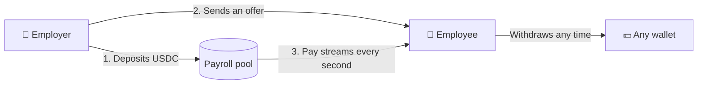

<p align="center">
  <picture>
    <source media="(prefers-color-scheme: dark)" srcset="brand/streamarc-logo-dark.png" />
    
  </picture>
</p>

<h3 align="center">Payroll that pays every second.</h3>

<p align="center">
  Salaries in USDC that stream to your team in real time, on Arc.
</p>

<p align="center">
  
  
  
</p>

---

## What is StreamArc?

Most people work every day but get paid once or twice a month. Until payday, the money they've earned sits with their
employer.

**StreamArc pays salaries by the second.** An employer puts USDC into one payroll pool, and each employee's pay flows out
of it continuously. Employees can watch their balance grow in real time and withdraw what they've earned whenever they
like.

It runs on [Arc](https://arc.io), Circle's blockchain built for stablecoins, so everything stays in US dollars from start
to finish.

## How it works



1. **Fund the pool.** The employer deposits USDC once. It's held by an open-source smart contract, not by us.
2. **Send offers.** Pick a salary and how often it unlocks. The employee accepts the offer from their wallet.
3. **Get paid continuously.** Earnings grow every second. Employees withdraw whenever they want, to any wallet.

## Features

|                    | For employers                                                | For employees                                        |
| ------------------ | ------------------------------------------------------------ | ---------------------------------------------------- |
| **Paying**         | One pool funds the whole team                                | Earnings grow every second, live on screen           |
| **Scheduling**     | Choose every second, weekly or every 30 days                 | Withdraw anything that has unlocked, any time        |
| **Hiring**         | Send one offer or hire a whole list in a single transaction  | Accept or decline offers from your wallet            |
| **Changes**        | Raises apply instantly; pause, resume or end any stream      | Pay cuts and schedule changes need your approval     |
| **Visibility**     | Dashboard shows what's owed, monthly cost and runway in days | Unpaid wages stay on record if the pool runs dry     |

**Built-in safety:** an employer can never withdraw money that's owed to their team. If the pool runs out, unpaid wages
are recorded and paid first when it's topped up.

## Why Arc

- **Gas is paid in USDC.** Employees never need to buy a second token just to collect their salary.
- **Fast and cheap.** Transactions settle in under a second for about a cent.
- **Dollars end to end.** Deposit, salary and withdrawal are all USDC.

## Roadmap

Payroll is the first product. The same streaming engine is already deployed on Arc for what comes next.

**✅ Live now**

- Per-second USDC payroll with offers, payday schedules and bulk hiring
- Employer dashboard with runway, and an employee view with live earnings
- Light and dark mode, Arc mainnet and testnet

**🔜 Next**

- **Vesting grants:** token and USDC grants with cliffs and gradual unlocks
- **Open-ended streams:** retainers and subscriptions with top-ups, pauses and refunds
- **Vesting airdrops:** send to thousands of wallets from a list, unlocking over time

**🔭 Later**

- **Salary advances:** every stream is an NFT, so employees could borrow against future pay
- **Team accounts:** run payroll from a shared multisig wallet
- **Fund from any chain:** top up the payroll pool with USDC from other blockchains

## Deployments

All contracts share the same addresses on Arc mainnet (chain `5042`, [explorer](https://explorer.arc.io)) and Arc
testnet (chain `5042002`, [explorer](https://explorer.testnet.arc.io)).

<details>
<summary><b>Contract addresses</b></summary>

| Contract                   | Address                                      |
| -------------------------- | -------------------------------------------- |
| PayrollVault               | `0xe9C616E7604b39D11851Ae0467077b10E5111685` |
| Comptroller (proxy)        | `0xB6056CA73Beaa2baF03419f3CAA2e0Ba564Fe727` |
| Comptroller implementation | `0x9b9B8d20EB83b7A67aDC742D3db83cc45f4C9198` |
| Lockup                     | `0x7FB00Dd54C509D1b698610aC781cf92829497F08` |
| BatchLockup                | `0xFfd8FE53f6C29Ed6BE387e06580675305439d0Da` |
| LockupNFTDescriptor        | `0xF13d46904999B77f9134B2124a602750A067119c` |
| Flow                       | `0x55F92fa58a5AB9227E40c5393DAAe8FEb43D0803` |
| FlowNFTDescriptor          | `0xc509b8b301094bAbA6a5012C1C921178dEA838B3` |
| FactoryMerkleInstant       | `0x185397C53851DdBb8Dc81Bf454d31536F2Bd3AeF` |
| FactoryMerkleLL            | `0x333D1EFFdF449f821d53117743dfB10eCC320471` |
| FactoryMerkleLT            | `0x957508527fE3e4659255907D5d69B9e83218C995` |
| FactoryMerkleVCA           | `0x4990425EE5377A19ec56734EeAF3800c8fF2d2Be` |
| FactoryMerkleExecute       | `0x10E1519e5dC3B6cB94Ad39419501C8d918eb4fAE` |

</details>

## For developers

<details>
<summary><b>Project layout</b></summary>

| Folder     | What's inside                                                                 |
| ---------- | ----------------------------------------------------------------------------- |
| `payroll`  | `PayrollVault`, the payroll contract                                          |
| `app`      | The website: landing page at `/` and dashboard at `/app/` (Vite + React)      |
| `lockup`   | Vesting contracts: linear, cliffs, custom curves, tranches                    |
| `flow`     | Open-ended streams with top-ups, pauses, rate changes and refunds             |
| `airdrops` | Merkle airdrop factories that pay instantly or vest                           |
| `utils`    | `StreamArcComptroller`, admin and fee settings shared by all contracts        |
| `brand`    | StreamArc logos                                                               |

Every stream in `lockup` and `flow` is an NFT with on-chain artwork.

</details>

<details>
<summary><b>Run the app</b></summary>

```bash
cd app
npm install
npm run dev
```

Open `http://localhost:5173`. The dashboard has a Mainnet / Testnet switch, and `?network=testnet` opens a link on
testnet. Add `?as=<address>` to view any account read-only. Free testnet USDC: [faucet.circle.com](https://faucet.circle.com).

The app deploys on Vercel with Root Directory `app` (Vite preset, output `dist`).

</details>

<details>
<summary><b>Run the tests</b></summary>

Requires [Foundry](https://getfoundry.sh) and [Bun](https://bun.sh).

```bash
cd payroll && forge test

for d in utils lockup flow airdrops; do (cd $d && bun install); done
for d in utils lockup flow airdrops; do (cd $d && FOUNDRY_PROFILE=lite forge test --no-match-path "*fork*"); done
```

Expected: 22 payroll tests and 1,482 streaming tests pass.

</details>

<details>
<summary><b>Deploy</b></summary>

```bash
# Local chain: full scenario with vesting, salary, withdrawals and debt
anvil --chain-id 5042002 &
RPC_URL=http://127.0.0.1:8545 PRIVATE_KEY=<anvil key 0> ./deploy-arc.sh && ./smoke-test-local.sh

# Testnet, then a live check with about 3 USDC
RPC_URL=https://rpc.testnet.arc.io PRIVATE_KEY=0x... ./deploy-arc.sh
RPC_URL=https://rpc.testnet.arc.io EMPLOYER_KEY=0x... EMPLOYEE_KEY=0x... ./live-check-arc.sh

# Mainnet
RPC_URL=https://rpc.mainnet.arc.io PRIVATE_KEY=0x... ARC_ADMIN=<safe> ./deploy-arc.sh
```

`deploy-arc.sh` deploys Comptroller → Lockup → Flow → Airdrops → PayrollVault, writes every address to
`deployments/arc-<chainId>.json`, and sets that network's vault address in `app/config.json`.

</details>

<details>
<summary><b>Arc details</b></summary>

- **USDC** ERC-20 interface: `0x3600000000000000000000000000000000000000`, 6 decimals.
- **Flow rates are 18-decimal** regardless of token: `1e18` = 1 USDC per second. $3,000 per 30 days =
  `1157407407407407`.
- **Lockup cliffs** vest nothing during the cliff unless a cliff-unlock amount is set. For "25% at the cliff, then
  linear", pass the 25% as the cliff-unlock amount.
- **Fees are zero.** The Comptroller has no price oracle; a fixed 1:1 oracle could enable fees later.
- **Admin** is the deployer or `ARC_ADMIN`. Use a Safe multisig on mainnet.

</details>

## License

Open source under GPL-3.0-or-later. See [LICENSE.md](./LICENSE.md) and [NOTICE](./NOTICE).
